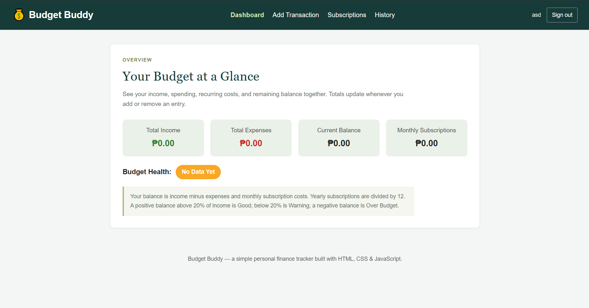
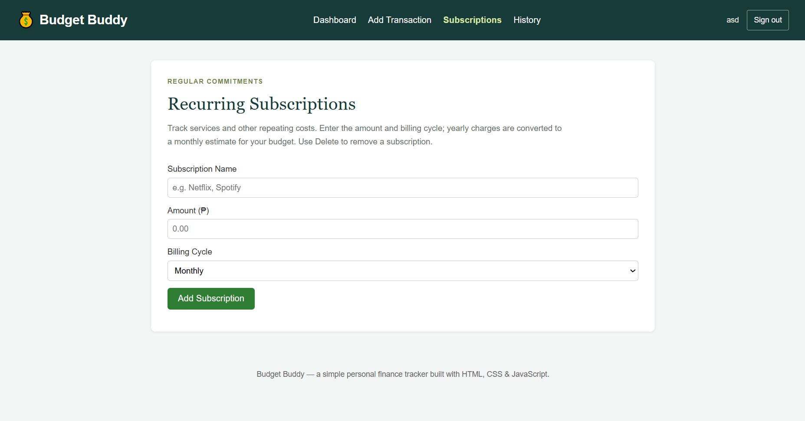
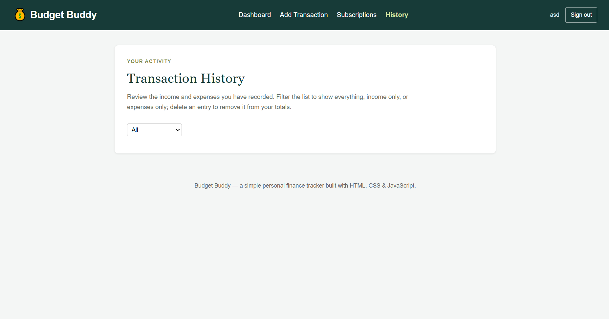

[README.md](https://github.com/user-attachments/files/32670832/README.md)
# Budget Buddy

A simple browser-based personal finance and subscription tracker. Users can log income and expenses, manage recurring subscriptions, filter their transaction history, and see a real-time budget health indicator.

**Current phase:** The Milestone 2 transaction-backend slice is implemented. Express serves the app and stores transactions in a JSON file. Subscriptions, budgets, and the prototype sign-in session still use browser `localStorage`.

---

## Screenshots

### Sign Up


### Sign In


### Dashboard


### Add Transaction


### Subscription


### History


---

## Tech Stack

- HTML
- CSS
- JavaScript (vanilla, no frameworks)
- Node.js and Express
- JSON-file transaction storage
- Browser localStorage (subscriptions, budgets, and prototype sign-in)

---

## Project Structure

```
budget-buddy/
├── app.js              # Express server and transaction routes
├── transactionStore.js # JSON-file transaction storage
├── package.json        # Project scripts and dependencies
├── package-lock.json   # Locked npm dependency versions
├── .gitignore          # Excludes node_modules and runtime transactions
├── public/
│   ├── index.html      # Authentication and hash-routed app views
│   ├── css/
│   │   └── style.css   # Authentication, navigation, and app styling
│   └── js/
│       └── main.js     # Authentication prototype, routing, and tracker logic
├── img/                # Screenshots shown in this README
├── data/
│   └── transactions.json  # Created at runtime; ignored by Git
└── docs/
```

The app uses one HTML document with separate hash-routed views for Dashboard, Add Transaction, Subscriptions, and History. The page links its CSS and JavaScript like this:
```html
<link rel="stylesheet" href="css/style.css">
<script src="js/main.js"></script>
```
These paths are relative to `public/index.html`.

---

## How to Run It

Install the project dependencies, then start the Express server from the project root:
```bash
npm install
npm start
```
Open the local URL printed by the server (by default, `http://localhost:3000`).
Set the `PORT` environment variable to use another local port.

---

## Transaction API

The browser and API use the same Express server, so no separate frontend server or CORS setup is needed.

| Method | Path | Behavior |
|---|---|---|
| `GET` | `/api/health` | Returns `200` JSON server status |
| `GET` | `/api/transactions` | Returns the saved transaction array |
| `POST` | `/api/transactions` | Validates and saves a transaction; returns `201` and its server-generated ID |
| `PUT` | `/api/transactions/:id` | Validates and saves changed fields; returns `200` with the transaction |
| `DELETE` | `/api/transactions/:id` | Saves removal and returns `204` |

Invalid fields and malformed JSON return `400`; unknown update/delete IDs return `404`; unexpected server or storage errors return a generic JSON `500`.

## Features

| Feature | Where |
|---|---|
| Add income/expense | "Add a Transaction" form |
| Add recurring subscription (Monthly/Yearly) with a next renewal date and reminder lead time | "Recurring Subscriptions" form |
| View upcoming renewals and optionally receive browser notifications | Renewal Reminders on the Subscriptions page |
| Filter transactions (All / Income / Expenses) | Dropdown above transaction history |
| Export all or filtered transaction history as a spreadsheet-friendly CSV | Export CSV button on History |
| Edit a transaction | Edit button in transaction history |
| Delete a subscription | Delete button on each subscription |
| Delete a transaction | Delete button in transaction history |
| Live totals (income, expenses, balance, subscriptions) | Dashboard cards |
| Budget health indicator (Good / Warning / Over Budget) | Badge below the dashboard cards |
| Monthly spending limits by category with progress, remaining, and over-budget amounts | Dashboard category budgets |
| Prototype sign-in and sign-up (any non-empty text is accepted) | Authentication screen |
| Navigate between app views | Navigation bar |

---

## How the Budget Health Indicator Works

1. Adds up all income and all expenses.
2. Adds up subscriptions, turning yearly ones into a monthly amount (`yearly amount ÷ 12`).
3. Balance = Income − Expenses − Monthly Subscriptions.
4. Badge color:
   - 🟩 **Good** — balance is more than 20% of income
   - 🟨 **Warning** — balance is positive but less than 20% of income
   - 🟥 **Over Budget** — balance is negative

---

## Notes

- Transactions are stored by the server in `data/transactions.json`. The file is created when transactions are first requested and is ignored by Git.
- On first load, existing browser transactions are imported once only if the backend is empty. The browser copy is removed only after the server confirms import; a failed or interrupted import keeps it for retry. If the backend already contains transactions, the browser copy is left untouched to avoid duplicates.
- Subscriptions, category budgets, and the prototype sign-in session are stored in the current browser (`localStorage`).
- Manual checks covered CRUD responses and validation, persistence across a server restart, frontend success/failure feedback, filtering, CSV export, dashboard calculations, and private data-file access.
- Authentication is for prototype demonstration only. There is no backend, credential validation, or secure account system; do not enter real passwords.
- Subscription reminder dates are stored locally. Browser notifications require permission and work only while Budget Buddy is open in a supported secure browser context; upcoming dates remain listed in the app.
- This is a local learning implementation. The JSON-file backend is single-user and is not suitable for real financial information or public deployment.
